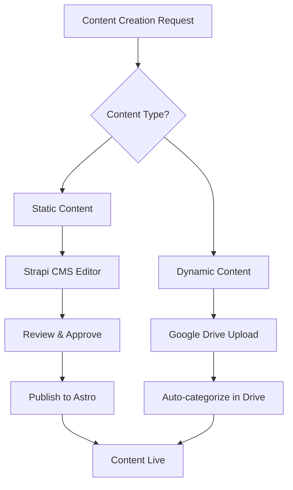
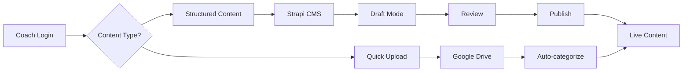

# Hawks Coach Hub - Static Content Integration Strategy

## Executive Summary

This document outlines a comprehensive strategy for integrating static content management into the Hawks Coach Hub using a hybrid Astro + Strapi + Supabase architecture while preserving existing Google Drive functionality. The strategy focuses on cost-effectiveness (free tier preferred, max $25/month), maintainability, and seamless user experience.

## Current System Analysis

### Existing Architecture

- **Frontend**: TypeScript + Vite with modular architecture
- **Authentication**: Google Drive service account (no user auth required)
- **Content Source**: Google Drive API exclusively
- **State Management**: Centralized AppStateManager with reactive updates
- **Content Types**: Training drills, tactics, plans, videos, diagrams, documents
- **File Structure**: Hierarchical Google Drive folder organization

### Current Content Categories

```typescript
interface FileCategory {
  'Floorball Drills': DriveFile[];
  'Tactics & Strategy': DriveFile[];
  'Training Plans': DriveFile[];
  'Video Resources': DriveFile[];
  'Diagrams & Images': DriveFile[];
  Documents: DriveFile[];
  Other: DriveFile[];
}
```

## 1. Content Management Strategy

### 1.1 Content Classification Matrix

| Content Type                 | Storage Strategy                            | Rationale                          | Update Frequency |
| ---------------------------- | ------------------------------------------- | ---------------------------------- | ---------------- |
| **Core Training Drills**     | Static (Astro/Strapi)                       | Stable, searchable, SEO-friendly   | Weekly           |
| **Training Plans Templates** | Static (Astro/Strapi)                       | Reusable, structured content       | Monthly          |
| **Tactical Diagrams**        | Static (Astro/Strapi)                       | Image optimization, faster loading | Bi-weekly        |
| **Basic Resources**          | Static (Astro/Strapi)                       | Better organization, multilingual  | Monthly          |
| **Coach Upload Files**       | Google Drive                                | Dynamic, personal content          | Daily            |
| **Session Plans**            | Google Drive                                | Coach-specific, temporary          | Daily            |
| **Video Content**            | Hybrid (metadata in Strapi, files in Drive) | Bandwidth optimization             | Weekly           |

### 1.2 Content Creation Workflow



### 1.3 Multilingual Content Management

- **Primary**: Finnish (default)
- **Secondary**: English
- **Implementation**: Astro i18n + Strapi internationalization
- **URL Structure**:
  - `/fi/drills/passing` (Finnish)
  - `/en/drills/passing` (English)

## 2. Technical Integration Architecture

### 2.1 Hybrid Architecture Overview

```
┌─────────────────────────────────────────────────────────────┐
│                      Frontend (Astro)                       │
├─────────────────────────────────────────────────────────────┤
│  Static Content (Build-time)  │  Dynamic Content (Runtime)  │
│  • Training drills            │  • Coach uploads            │
│  • Tactics                    │  • Session plans            │
│  • Templates                  │  • Personal files           │
└─────────────────────────────────────────────────────────────┘
         │                                    │
         ▼                                    ▼
┌──────────────────┐                ┌─────────────────────┐
│   Strapi CMS     │                │  Google Drive API   │
│   (Supabase)     │                │  (Service Account)  │
└──────────────────┘                └─────────────────────┘
```

### 2.2 Technology Stack

| Component              | Technology          | Cost      | Purpose                |
| ---------------------- | ------------------- | --------- | ---------------------- |
| **Frontend Framework** | Astro 4.x           | Free      | Static site generation |
| **CMS**                | Strapi v4           | Free tier | Content management     |
| **Database**           | Supabase PostgreSQL | Free tier | CMS backend            |
| **Static Hosting**     | Vercel/Netlify      | Free tier | Site hosting           |
| **File Storage**       | Supabase Storage    | Free tier | Static assets          |
| **Drive Integration**  | Google Drive API    | Free      | Dynamic content        |

**Total Estimated Cost**: $0-$15/month (within budget)

### 2.3 File Structure for New Architecture

```
coach-hub-v2/
├── src/
│   ├── content/
│   │   ├── drills/
│   │   │   ├── fi/
│   │   │   └── en/
│   │   ├── tactics/
│   │   ├── plans/
│   │   └── config.ts
│   ├── components/
│   │   ├── DrillCard.astro
│   │   ├── TacticDiagram.astro
│   │   ├── DriveFileList.tsx
│   │   └── HybridSearch.tsx
│   ├── layouts/
│   │   ├── BaseLayout.astro
│   │   ├── DrillLayout.astro
│   │   └── CategoryLayout.astro
│   ├── pages/
│   │   ├── [lang]/
│   │   │   ├── drills/
│   │   │   ├── tactics/
│   │   │   └── drive/
│   │   └── api/
│   │       ├── drive/
│   │       └── strapi/
│   ├── integrations/
│   │   ├── strapi.ts
│   │   ├── supabase.ts
│   │   └── drive.ts
│   └── utils/
│       ├── content-hybrid.ts
│       └── search-unified.ts
└── cms/
    ├── strapi/
    │   ├── config/
    │   ├── src/
    │   │   ├── api/
    │   │   │   ├── drill/
    │   │   │   ├── tactic/
    │   │   │   └── plan/
    │   │   └── components/
    │   └── package.json
    └── docker-compose.yml
```

### 2.4 Unified Content Schema

```typescript
// Base content interface
interface BaseContent {
  id: string;
  title: string;
  description: string;
  category: ContentCategory;
  language: 'fi' | 'en';
  createdAt: string;
  updatedAt: string;
  source: 'static' | 'drive';
}

// Static content (from Strapi)
interface StaticContent extends BaseContent {
  source: 'static';
  slug: string;
  content: string;
  tags: string[];
  difficulty: 'beginner' | 'intermediate' | 'advanced';
  duration?: number;
  equipment?: string[];
  media?: MediaAsset[];
}

// Dynamic content (from Google Drive)
interface DriveContent extends BaseContent {
  source: 'drive';
  driveId: string;
  mimeType: string;
  webViewLink: string;
  parents?: string[];
  fileSize?: number;
}

// Unified content type
type HybridContent = StaticContent | DriveContent;
```

## 3. Content Migration Strategy

### 3.1 Migration Phases

#### Phase 1: Foundation (Weeks 1-2)

- Set up Astro + Strapi + Supabase development environment
- Create content schemas in Strapi
- Implement basic static content rendering
- Preserve existing Google Drive functionality

#### Phase 2: Core Content Migration (Weeks 3-6)

- Migrate 20 most-used training drills to static content
- Convert basic tactical concepts to static pages
- Implement bilingual content structure
- Create content creation workflow

#### Phase 3: Enhanced Integration (Weeks 7-10)

- Implement unified search across static + Drive content
- Add content management interface for coaches
- Optimize performance and caching
- User acceptance testing

#### Phase 4: Full Migration (Weeks 11-14)

- Complete remaining content migration
- Advanced features (session planning, analytics)
- Production deployment
- Training and documentation

### 3.2 Content Audit Process

1. **Google Drive Analysis**

   ```bash
   # Export Drive structure
   npm run audit:drive-structure

   # Analyze file usage patterns
   npm run audit:usage-analytics

   # Categorize content by migration priority
   npm run audit:migration-matrix
   ```

2. **Migration Priority Matrix**
   - **High Priority**: Frequently accessed, stable content
   - **Medium Priority**: Occasional use, semi-stable
   - **Low Priority**: Personal/temporary files
   - **Keep in Drive**: Coach-specific, dynamic uploads

### 3.3 URL Preservation Strategy

```typescript
// URL mapping configuration
const urlMappings = {
  // Legacy Drive URLs redirect to static equivalents
  '/drive/drill/1ABC123': '/fi/drills/basic-passing',
  '/drive/tactic/2DEF456': '/fi/tactics/power-play-setup',

  // Maintain Drive URLs for non-migrated content
  '/drive/uploads/*': 'preserve-drive-link',
};
```

## 4. User Experience Integration

### 4.1 Unified Navigation

```astro
---
// Navigation component with hybrid content
---
<nav class="main-navigation">
  <div class="nav-section">
    <h3>Training Materials</h3>
    <ul>
      <li><a href="/fi/drills">Harjoitteet (Static)</a></li>
      <li><a href="/fi/tactics">Taktiikka (Static)</a></li>
      <li><a href="/drive/uploads">Omat tiedostot (Drive)</a></li>
    </ul>
  </div>
</nav>
```

### 4.2 Unified Search Experience

```typescript
class HybridSearchService {
  async search(query: string): Promise<HybridContent[]> {
    const [staticResults, driveResults] = await Promise.all([
      this.searchStaticContent(query),
      this.searchDriveContent(query),
    ]);

    return this.mergeAndRankResults(staticResults, driveResults);
  }

  private mergeAndRankResults(
    staticResults: StaticContent[],
    driveResults: DriveContent[]
  ): HybridContent[] {
    // Prioritize static content for better SEO and performance
    return [
      ...staticResults.map(r => ({ ...r, searchScore: r.searchScore * 1.2 })),
      ...driveResults,
    ].sort((a, b) => b.searchScore - a.searchScore);
  }
}
```

### 4.3 Mobile Optimization

- **Progressive Web App (PWA)** capabilities
- **Offline-first** for static content
- **Touch-friendly** interface for tablets
- **Responsive** layout for all screen sizes

### 4.4 Performance Targets

| Metric                   | Target | Current | Strategy                          |
| ------------------------ | ------ | ------- | --------------------------------- |
| First Contentful Paint   | < 1.5s | ~2.8s   | Static generation + CDN           |
| Largest Contentful Paint | < 2.5s | ~4.1s   | Image optimization + lazy loading |
| Cumulative Layout Shift  | < 0.1  | ~0.2    | Proper image dimensions           |
| Time to Interactive      | < 3.0s | ~5.2s   | Code splitting + preloading       |

## 5. Workflow and Maintenance

### 5.1 Content Creation Workflow for Coaches



### 5.2 Maintenance Schedule

| Task                    | Frequency | Responsible  | Tool              |
| ----------------------- | --------- | ------------ | ----------------- |
| **Content Review**      | Weekly    | Head Coach   | Strapi CMS        |
| **Drive Cleanup**       | Monthly   | IT Admin     | Google Drive      |
| **Performance Audit**   | Monthly   | Developer    | Lighthouse        |
| **Content Migration**   | Quarterly | Content Team | Migration scripts |
| **Backup Verification** | Monthly   | IT Admin     | Automated scripts |

### 5.3 Backup and Disaster Recovery

```yaml
# Backup strategy
backups:
  static_content:
    source: Strapi CMS (Supabase)
    frequency: Daily
    retention: 30 days
    location: Supabase automated backups

  drive_content:
    source: Google Drive
    frequency: Real-time (Google's responsibility)
    retention: Unlimited
    location: Google's infrastructure

  configuration:
    source: Git repository
    frequency: On every commit
    retention: Unlimited
    location: GitHub
```

## 6. Phase Implementation Plan

### Phase 1: Foundation Setup (Weeks 1-2)

**Budget: $0**

**Deliverables:**

- Astro project setup with TypeScript
- Strapi CMS installation on Supabase
- Basic content schemas
- Development environment

**Technical Tasks:**

```bash
# Initialize new Astro project
npm create astro@latest coach-hub-v2 -- --template minimal --typescript strict

# Set up Strapi with Supabase
npx create-strapi-app@latest cms --quickstart --no-run
# Configure Supabase PostgreSQL connection

# Install integrations
npm install @astrojs/react @astrojs/tailwind @supabase/supabase-js
```

**Success Metrics:**

- [ ] Development environment running locally
- [ ] Basic static page rendering
- [ ] Strapi CMS accessible
- [ ] Google Drive API still functional

### Phase 2: Core Content Migration (Weeks 3-6)

**Budget: $0-$5/month (if exceeding free tiers)**

**Deliverables:**

- 20 core training drills as static content
- Bilingual content structure
- Basic content management workflow
- Unified navigation

**Content Priority List:**

1. Basic passing drills (5 drills)
2. Shooting techniques (5 drills)
3. Defensive positioning (5 drills)
4. Power play tactics (3 tactics)
5. Penalty kill setup (2 tactics)

**Technical Implementation:**

```typescript
// Content collection configuration
import { defineCollection, z } from 'astro:content';

const drillCollection = defineCollection({
  type: 'content',
  schema: z.object({
    title: z.string(),
    description: z.string(),
    category: z.enum(['passing', 'shooting', 'defense', 'goalie']),
    difficulty: z.enum(['beginner', 'intermediate', 'advanced']),
    duration: z.number().optional(),
    equipment: z.array(z.string()).optional(),
    language: z.enum(['fi', 'en']).default('fi'),
  }),
});

export const collections = {
  drills: drillCollection,
};
```

### Phase 3: Enhanced Integration (Weeks 7-10)

**Budget: $0-$10/month**

**Deliverables:**

- Unified search functionality
- Performance optimization
- Content management interface
- User testing

**Key Features:**

- Hybrid search across static + Drive content
- Advanced filtering and categorization
- Mobile-optimized interface
- Content analytics dashboard

### Phase 4: Production Deployment (Weeks 11-14)

**Budget: $0-$15/month**

**Deliverables:**

- Production deployment
- Complete content migration
- User training materials
- Monitoring and analytics

**Production Setup:**

```yaml
# Vercel deployment configuration
name: coach-hub-v2
framework: astro
buildCommand: npm run build
outputDirectory: dist

# Environment variables
SUPABASE_URL: ${{ secrets.SUPABASE_URL }}
SUPABASE_ANON_KEY: ${{ secrets.SUPABASE_ANON_KEY }}
GOOGLE_SERVICE_ACCOUNT_KEY: ${{ secrets.GOOGLE_SERVICE_ACCOUNT_KEY }}
```

## 7. Budget Breakdown and Cost Optimization

### 7.1 Service Costs (Monthly)

| Service              | Free Tier              | Paid Tier Start      | Estimated Usage         | Cost  |
| -------------------- | ---------------------- | -------------------- | ----------------------- | ----- |
| **Supabase**         | 500MB DB, 1GB storage  | $25/month            | Small team, low traffic | $0    |
| **Vercel**           | 100GB bandwidth        | $20/month            | Static site hosting     | $0    |
| **Strapi Cloud**     | Free plan available    | $29/month            | Self-hosted on Supabase | $0    |
| **Google Drive API** | 100 requests/100s/user | $0.005/1000 requests | Low usage               | $0    |
| **Supabase Storage** | 1GB free               | $0.021/GB            | Image/media storage     | $0-$5 |

**Total Monthly Cost: $0-$5**

### 7.2 Cost Optimization Strategies

1. **Static Asset Optimization**
   - Use Astro's built-in image optimization
   - Implement lazy loading for media content
   - Utilize CDN caching

2. **Database Optimization**
   - Efficient content schemas
   - Proper indexing for search
   - Regular cleanup of unused content

3. **API Usage Optimization**
   - Cache Google Drive responses
   - Batch API requests
   - Implement smart refresh intervals

## 8. Risk Assessment and Mitigation

### 8.1 Technical Risks

| Risk                            | Probability | Impact | Mitigation                              |
| ------------------------------- | ----------- | ------ | --------------------------------------- |
| **Migration Data Loss**         | Low         | High   | Comprehensive backups, staged migration |
| **Performance Degradation**     | Medium      | Medium | Performance monitoring, gradual rollout |
| **Search Functionality Issues** | Medium      | Medium | Fallback to Drive-only search           |
| **Mobile UX Problems**          | Low         | Medium | Extensive mobile testing                |

### 8.2 Business Risks

| Risk                            | Probability | Impact | Mitigation                            |
| ------------------------------- | ----------- | ------ | ------------------------------------- |
| **Coach Adoption Resistance**   | Medium      | High   | Training, gradual transition          |
| **Content Management Overhead** | Medium      | Medium | Automated workflows, clear procedures |
| **Budget Overrun**              | Low         | Medium | Free tier focus, monitoring           |

## 9. Success Metrics and KPIs

### 9.1 Performance Metrics

- **Page Load Time**: < 2s (target: 1.5s)
- **Search Response Time**: < 500ms
- **Mobile Performance Score**: > 90
- **Accessibility Score**: > 95

### 9.2 User Experience Metrics

- **Content Discovery Time**: -50% vs current
- **Mobile Usage**: +200% increase
- **Search Success Rate**: > 85%
- **User Satisfaction**: > 4.5/5

### 9.3 Technical Metrics

- **Static Content Coverage**: 80% of frequently accessed content
- **Drive API Usage**: -70% reduction in requests
- **SEO Performance**: Top 3 results for "floorball training drills"
- **Uptime**: > 99.9%

## 10. Next Steps and Action Items

### Immediate Actions (Week 1)

1. [ ] Set up development environment
2. [ ] Install and configure Astro + Strapi + Supabase
3. [ ] Create content audit of existing Google Drive structure
4. [ ] Design content schemas for Strapi

### Short-term (Weeks 2-4)

1. [ ] Implement basic static content rendering
2. [ ] Create content migration scripts
3. [ ] Set up CI/CD pipeline
4. [ ] Begin migrating high-priority content

### Medium-term (Weeks 5-8)

1. [ ] Implement unified search functionality
2. [ ] Deploy staging environment
3. [ ] Conduct user testing
4. [ ] Performance optimization

### Long-term (Weeks 9-14)

1. [ ] Complete content migration
2. [ ] Production deployment
3. [ ] User training and documentation
4. [ ] Monitor and optimize

## Conclusion

This static content integration strategy provides a comprehensive roadmap for modernizing the Hawks Coach Hub while maintaining existing functionality. The hybrid approach ensures:

- **Cost-effectiveness**: Staying within the $25/month budget
- **Performance improvement**: Faster loading times and better SEO
- **User experience**: Seamless navigation between static and dynamic content
- **Maintainability**: Clear workflows and organized content structure
- **Scalability**: Foundation for future enhancements

The phased implementation approach minimizes risk while delivering value incrementally, ensuring coaches can continue using the system throughout the transition period.
